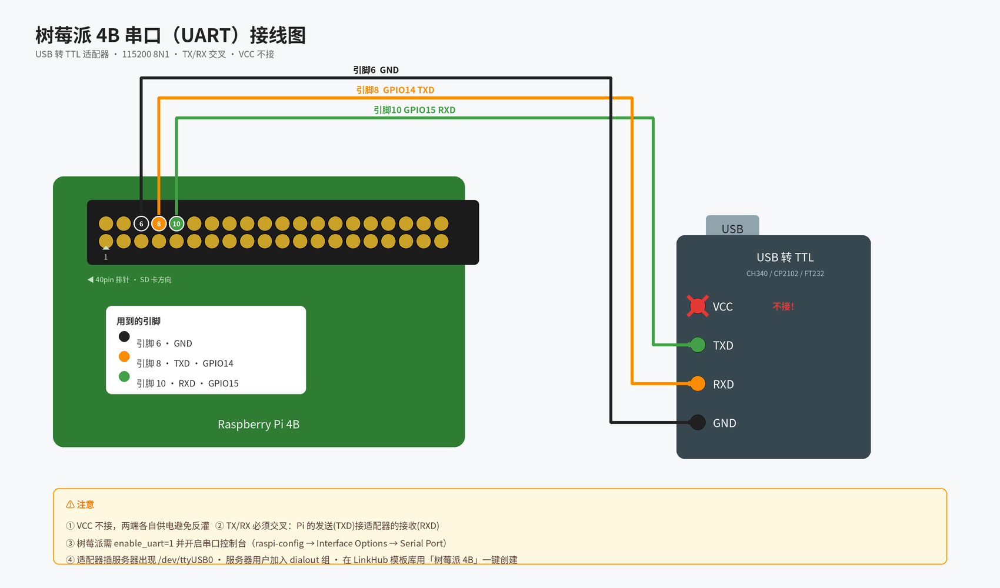

# 🐙 灵枢 LinkHub — 设备连接平台

> 一个平台，连接所有设备。
> 吉祥物：**连连**，一只八条触手各握一种线缆的小章鱼 🐙

```
        _______________
       /  灵枢 LinkHub \
      |   ___________   |
      |  /           \  |
      | |  ^     ^   |  |      触手即连接：
      | |  •  ω  •   |  |  ┌── USB/串口 ── 树莓派
       \ \   ‿‿‿   / /   ├── SSH ──────── 开发板/服务器
        \ \_______/ /    ├── 桌面共享 ──── Windows/Linux 远程桌面（内置采集，免装软件）
       ~/|  |   |  |\~   └── MQTT ─────── IoT 设备群
      ~ / |  |   |  | \ ~
       /  |  |   |  |  \
     USB  TX RX  GND  BLE ...
```

## 这是什么

灵枢 LinkHub 是统一的设备连接与管理平台：Go 后端通过**插件化连接器**适配一切设备接入方式
（串口/USB、SSH、Telnet、蓝牙、MQTT……），Vue3 前端提供设备台账、配置模板库、
浏览器内全功能终端，以及 **Windows/Linux 远程桌面共享**（内置采集双模式：VNC 或
进程内抓屏，免装第三方软件）。

## 功能特性

- 🖥️ **设备台账**：设备 CRUD、分组、标签、在线状态实时徽标
- 📦 **模板库**：内置树莓派 4B/5、香蕉派 BPI-M4、香橙派 5、ESP32、Arduino Uno，一键套用
- 🔌 **五类连接器**：串口/USB、**SSH**、**Telnet**、**BLE 蓝牙**（含扫描发现）、**MQTT**——插件体系，新协议一个文件
- 🖥️ **Web 终端**：xterm.js 全双工终端、断线重连、密码遮蔽、tmux 尺寸适配、日志回放导出
- 🖥️ **远程桌面**：内置采集（Windows Magnification/GDI + X11）零依赖共享桌面，块差分 JPEG
  流 + 鼠标键盘注入 + 剪贴板同步（文本/文件）；VNC 模式兼容存量 x11vnc/TightVNC；
  锁屏密码页可远程解锁（Windows 需 SYSTEM 计划任务部署，见 `scripts/windows-linkhub-system.xml`）
- 👥 **多人协作终端**：主控/旁观模式，申请输入 + 主控弹窗授权，非模态不打断
- 🔐 **认证与 RBAC**：JWT 登录、admin/operator/viewer 三角色、审计日志、凭证保险库（AES-GCM）
- ⏰ **自动化**：多步骤脚本编排（playbook，跨节点串/并行）+ 定时任务（巡检采集，带历史）
- 🕸️ **集群联邦**：多节点对等组网，共享各自本机连接资源；跨节点终端/桌面/SFTP 中继、
  批量命令；UDP 广播/静态种子/定向三通道节点发现
- 📊 **节点监控**：系统指标（CPU/内存/磁盘/网络/进程）+ eBPF 流量监控（Linux，需 root）

## 登录

首次启动自动创建 **admin / admin**，登录后请到「系统管理 → 用户」立即改密。

## 快速开始

单文件分发：前端产物经 `go:embed` 打进二进制，只需一个 `linkhub` 可执行文件 + 数据目录。

```bash
# 构建（Go 1.22+）
cd linkhub-go && go build -o linkhub .

# 运行（默认 :8000，数据目录 ~/.linkhub）
./linkhub
# 打开 http://127.0.0.1:8000
```

Windows 双击 `scripts/start.bat`（自动定位 exe、日志落盘 start.log、防闪退自检）。

### 集群模式（多机联邦）

每台节点都是对等方：谁插线，谁当家。打开任意节点的界面，即可看到并操作全集群的设备。

```bash
# 每台机器启动时加三个环境变量（令牌全集群一致）
LINKHUB_CLUSTER_ENABLED=true \
LINKHUB_CLUSTER_TOKEN=$(openssl rand -hex 32) \
LINKHUB_NODE_NAME=实验室主机A \
LINKHUB_ADVERTISE_ADDR=http://192.168.1.10:8000 \
./linkhub
```

- **手动加入**：集群管理页 → 加入节点 → 填任一已在集群中的节点地址（握手后自动 gossip 互认）
- **自动发现**：UDP 广播（单网段，最可靠）+ 静态种子（跨网段 `LINKHUB_CLUSTER_SEEDS`）；
  发现的节点出现在"发现的节点"列表，**勾选后一键加入，或一键忽略**
- **跨网段注意**：种子/对端地址必须写**对方本机网络可达**的地址——多网卡机器的自动推导
  地址可能落在对端不可达的网段（以启动日志打印的 `自动推导广播地址` 为准，可用
  `LINKHUB_ADVERTISE_ADDR` 显式指定）
- **跨节点终端/桌面**：设备列表里远程设备带节点徽标 → 打开，字节流经本节点中转到归属节点
- **批量执行**：设备列表勾选多台（可跨节点）→ 批量执行 → 一条命令并发下发、分节点汇总输出
- **离线容错**：节点掉线 15s 内标灰，设备保留可见；恢复后自动重连并对账设备目录

### 多机部署示例（3 台）

拓扑：A `192.168.1.10`（插树莓派）、B `192.168.1.11`（插香橙派）、C `192.168.1.12`（纯操作端）。

```bash
# 0. 三台都拉代码并构建（任选一机生成令牌，三机共用）
git clone https://github.com/zjiek327/linkhub.git && cd linkhub/linkhub-go
go build -o linkhub .
TOKEN=$(openssl rand -hex 32)    # 只生成一次，抄到另外两台

# 1. 电脑 A（192.168.1.10）
LINKHUB_CLUSTER_ENABLED=true LINKHUB_CLUSTER_TOKEN=$TOKEN \
LINKHUB_NODE_NAME=主机A LINKHUB_ADVERTISE_ADDR=http://192.168.1.10:8000 \
./linkhub

# 2. 电脑 B/C 同上，改 NODE_NAME 和 ADVERTISE_ADDR；不插板子也能当操作端

# 3. 组网（任选一台执行一次，gossip 会自动互认其余节点）
curl -X POST http://192.168.1.11:8000/api/cluster/join \
  -H 'Content-Type: application/json' -d '{"address":"http://192.168.1.10:8000"}'
```

同网段可跳过第 3 步：节点会自动出现在彼此的"集群管理 → 发现的节点"里
（UDP 广播 37890 端口，3s 一轮），勾选加入即可。

验证（任一台）：`curl http://192.168.1.10:8000/api/cluster/nodes` 应看到三台 online。

注意事项：
- 防火墙放行 8000 端口（如 `sudo ufw allow 8000`）；Windows 首次会弹网络授权，选允许
- `ADVERTISE_ADDR` 必须填**别的机器能访问到**的地址（不要填 127.0.0.1）
- 各机 `CLUSTER_TOKEN` 不一致会握手 403

### 本地开发

```bash
# 后端（Go 1.22+，改完重新 go build 即生效；前端产物 embed 进二进制）
cd linkhub-go
go build -o linkhub . && ./linkhub      # http://127.0.0.1:8000

# 前端热更开发（Node 18+，Vite 代理 /api 与 /ws 到 :8000）
cd frontend
npm install
npm run dev                             # http://127.0.0.1:5173
```

前端改动交付链：`npm run build && rsync -a --delete dist/ ../linkhub-go/internal/api/dist/`
然后重编后端（embed 产物随二进制分发）。

### 连接树莓派 4B（验收路径）



1. **接线**：USB-TTL 的 TX → GPIO15（引脚10）、RX → GPIO14（引脚8）、GND → 引脚6，**VCC 不接**
2. **树莓派侧**：`/boot/firmware/config.txt` 加 `enable_uart=1`；`raspi-config → Interface Options → Serial Port` 开控制台
3. **平台侧**：模板库 → 树莓派 4B → 用模板创建 → 选择 `/dev/ttyUSB0` → 打开终端
4. 浏览器中出现 `raspberrypi login:`，登录，执行 `uname -a` 🎉

> 串口权限：Linux 需 `sudo usermod -aG dialout $USER`（重新登录生效）；Windows/macOS 无需配置。
> 特殊波特率（如香橙派 1500000）**仅 Linux 支持**自定义值；Windows/macOS 请改用标准 115200。

## 项目结构

```
linkhub-go/        Go 后端（单二进制，前端 embed 分发）
  internal/
    api/           REST 路由 + 集群代理 + SFTP + 剪贴板文件传输
    ws/            WebSocket（终端/桌面/VNC 中继）
    cluster/       集群联邦（发现/心跳/gossip/路由）
    desktop/       远程桌面：capture（Mag/GDI/X11 抓屏 + 块差分 JPEG 流）、
                   input（keysym 注入）、clipboard（文本 + CF_HDROP/uri-list 文件）
    connector/     连接器插件（serial/ssh/telnet/ble/mqtt）
    monitor/       系统指标 + eBPF 流量
    store/         SQLite 存储
  main.go          入口；serve_windows.go 独占端口（Windows 防双实例）
frontend/          Vue3 + Element Plus + xterm.js + noVNC
scripts/           start.bat（Windows 双击）/ SYSTEM 任务部署 / 排查探针
docs/              需求与架构设计文档
```

## 测试与检查

```bash
cd linkhub-go
go test ./...            # 单元测试
go vet ./...             # 静态检查
GOOS=windows go build ./...   # 全树交叉编译（平台相关代码已按 build tag 拆分）
```

## API 一览

| 方法 | 路径 | 说明 |
|---|---|---|
| GET/POST/PUT/DELETE | `/api/devices` | 设备 CRUD |
| POST | `/api/devices/from-template/{key}` | 模板一键建设备 |
| GET/POST | `/api/templates` | 模板库 |
| POST | `/api/connections/{id}/open` | 打开会话 |
| GET | `/api/serial/ports` | 枚举本机串口 |
| WS | `/ws/terminal/{session_id}` | 终端数据流 |
| WS | `/ws/desktop?node=<id>` | 远程桌面（内置采集/VNC 双模式） |
| WS | `/ws/events` | 状态事件总线 |

## 路线图

- [x] **P1** 串口/USB → 树莓派 4B 全闭环
- [x] **C1~C3** 集群联邦（发现/中继/批量/对账/自愈）+ 多人协作终端
- [x] **P2** SSH/Telnet 连接器、JWT 登录、RBAC 三角色、审计、凭证保险库
- [x] **P3** BLE 连接器（含扫描）、MQTT 连接器
- [x] **P4** 脚本编排 playbook、定时任务、会话日志导出
- [x] **D1~D4** 远程桌面（内置采集双模式、输入注入、剪贴板文本/文件、锁屏解锁）
- [x] **Go 化** 后端整体迁移 Go 单二进制（embed 前端，免 Python 环境）
- [ ] P5 模板市场、第三方插件 API、移动端
- [ ] C4 跨网段反向隧道、节点级 RBAC（按需）
